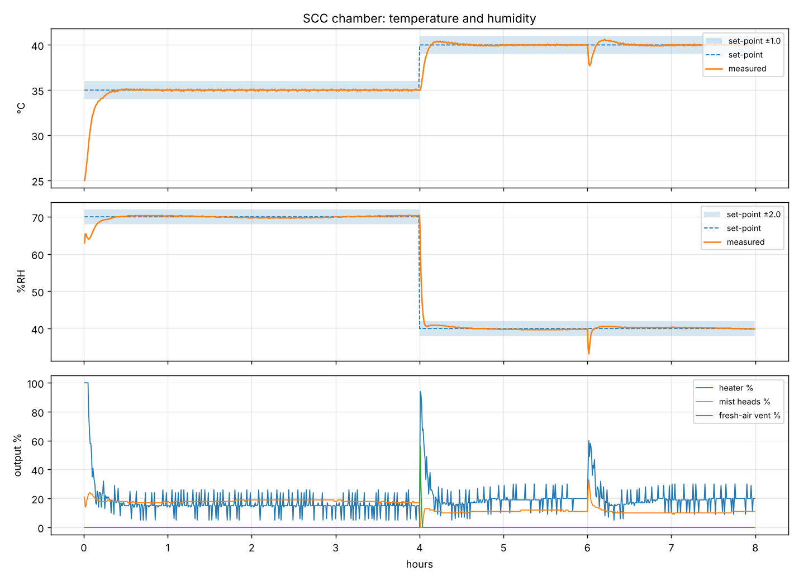

# SCC Salt-Fog Chamber Control

Arduino UNO R3 controller for a **stress corrosion cracking (SCC) test chamber**: a plastic box of **50 × 80 × 50 cm (200 L)**. It fills the chamber with **3.5 wt% NaCl salt fog** from 4 ultrasonic mist heads, holds a set temperature and relative humidity within **±1 °C** and **±2 %RH**, and records both.

> **สรุปภาษาไทย:** ตู้จำลองสภาวะไอน้ำทะเล พ่นหมอกน้ำเกลือ NaCl 3.5 %wt ด้วยหัวพ่น Ultrasonic 4 หัว (ทำงานพร้อมกัน ผ่าน DC/DC SSR)
> ควบคุมอุณหภูมิและความชื้นด้วย Arduino UNO R3 + DHT22 ให้อยู่ใน ±1 °C / ±2 %RH ตั้งค่าผ่านจอ LCD I²C พร้อมปุ่มกด
> และบันทึกข้อมูลลง microSD/คอมพิวเตอร์ ตู้พลาสติก 50 × 80 × 50 cm (200 ลิตร) ฮีตเตอร์เป็นแผ่นซิลิโคนบน Al heat sink มีครีบ + พัดลม **อยู่ในตู้**
> จึงต้องป้องกัน corrosion และไฟรั่ว (แนะนำ 24 VDC, เคลือบครีบ, KSD301 + thermal fuse) ดูหัวข้อ 0.5 ในเอกสารภาษาไทย
> คำอธิบายอุปกรณ์และเหตุผลการออกแบบภาษาไทย: **[docs/design-notes-th.md](docs/design-notes-th.md)**



## What's here

| Deliverable | Where |
|---|---|
| **Design notes (Thai)**: removed parts, pull-up, alarm/lighted button, MOSFET vs SSR, corrosion, mist heads | [docs/design-notes-th.md](docs/design-notes-th.md) |
| **Control system design**: loops, safety, simulation results | [docs/control-design.md](docs/control-design.md) |
| **Parts list** | [docs/parts-list.md](docs/parts-list.md) |
| **Wiring**: pin map, signal and power wiring, physical layout | [docs/wiring.md](docs/wiring.md) |
| **Arduino code** | [firmware/SCC_EnvControl/](firmware/SCC_EnvControl/) |
| Operation, keypad, logging, tuning | [docs/operation.md](docs/operation.md) |
| PC tools: serial logger, plot / tolerance report | [tools/](tools/) |
| Simulation and UI tests (run the real firmware on a PC) | [test/sim/](test/sim/) |

## System at a glance

```
 room air ─►[fresh-air blower D6]─► ┌──── plastic chamber 50×80×50 cm (200 L) ────┐ ─► passive outlet
            (outside the fog)       │  heater module: silicone pad on coated Al    │
                                    │  fins (D5 → SSR) + IP68 fan (D7)             │
                                    │  DHT22 (D2)          SCC specimens           │
                                    │  4 × ultrasonic mist heads (D3) in 3.5 % NaCl│
                                    └──────────────────────────────────────────────┘

  Arduino UNO R3 + Data Logging Shield (SD + RTC) + RGB LCD Shield (16x2, 5 keys)
  D8 → buzzer or lighted push button          free pins: D4, D9, A0–A3
```

* **Sensor:** DHT22 / AM2302 with a filter cap.
* **Temperature:** PID → 200–300 W silicone heater pad on a finned Al heat sink with a fan, inside the chamber (2 s time-proportioning through an SSR). It is protected against the salt fog: 24 VDC preferred, coated fins, sealed leads, bimetal + thermal fuse.
* **Operating range:** **20–40 °C or ROOM** (no heating), **20–80 %RH**, with humidity controlled mainly by the mist. There is no cooler, and RH below the room air's moisture needs a silica-gel inlet.
* **Humidity / fog:** one split-range PI. Positive output → the 4 mist heads (own drivers, switched together on one 5 V rail) sprayed in **timed bursts** of ≥ 0.3 s. Negative output → fresh-air blower.
* **All outputs are on/off** (time-proportioned): SSR-25DA for the 230 V heater (D5), and a DC/DC SSR for the mist-head supply (D3, in the 12 V feed of the 12→5 V step-down). MOSFET modules also work.
* **Input / display:** set T and RH with the keypad (or serial), saved in EEPROM. The backlight turns **green** when stable in tolerance and **red** on alarm.
* **Recording:** CSV to microSD (one file per day, RTC time stamps) and to USB serial.
* **Safety:** sensor-fail and over-temperature cut-outs, an out-of-band alarm, an 8 s watchdog, and a KSD301 75 °C bimetal plus ~100 °C thermal fuse on the heater heat sink.

## Quick start

1. Build the hardware per [parts-list](docs/parts-list.md) and [wiring](docs/wiring.md).
2. Mix the solution: **35.0 g NaCl + 965.0 g DI water per kg**.
3. In Arduino IDE, install **DHT sensor library**, **Adafruit Unified Sensor**, **Adafruit RGB LCD Shield Library** and **SD**.
4. Open `firmware/SCC_EnvControl/SCC_EnvControl.ino`, check `config.h`, and upload to **Arduino UNO**.
5. Serial Monitor at 115200 baud: `TIME 2026-10-14 09:00:00`, then `SET T 35` (or `SET T ROOM`) and `SET RH 70`. Or press **SELECT** on the keypad.
6. Wait for the green backlight. Press **STOP** before opening the lid.

## Firmware facts

* UNO R3 usage: **31,806 / 32,256 bytes of flash, 1,467 / 2,048 bytes of RAM**.
* On every push, GitHub Actions compiles the sketch for `arduino:avr:uno` and runs `test/sim/run.sh`. That covers the UI, fail-safe behaviour, and closed-loop tolerance checks on 15 variants of the 200 L chamber across the operating range.
* Gains come from simulation. Verify them on your chamber ([operation.md §5](docs/operation.md#5-tuning-on-the-real-chamber)).
