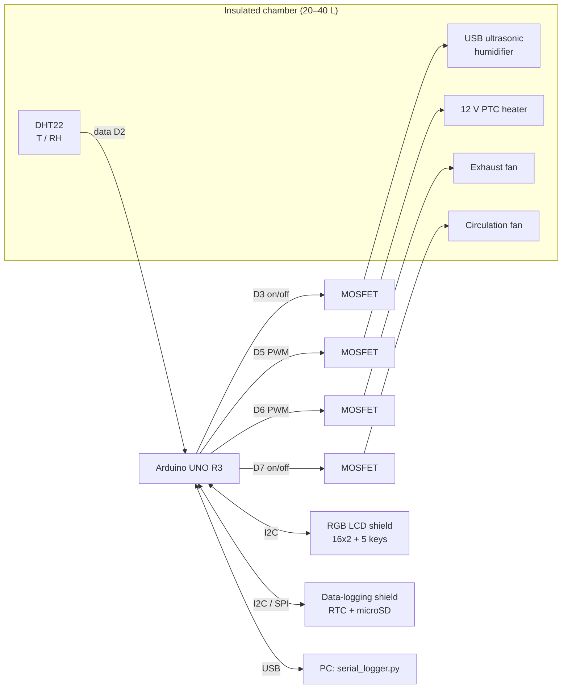

# Control System Design

## 1. Requirements

| Item | Requirement | How it is met |
|---|---|---|
| Controller | Arduino UNO R3 | ATmega328P. The sketch uses 32,008 of 32,256 bytes of flash and 1,454 of 2,048 bytes of static RAM |
| Humidity source | 1 × small USB ultrasonic humidifier | Switched by a MOSFET with slow time-proportioning |
| Sensor | 1 × DHT | **DHT22 / AM2302** (see §5) |
| Set-points | Target %RH and °C | Set from the LCD keypad or USB serial, saved in EEPROM |
| Tolerance | ±2 %RH, ±1 °C | PID / split-range PI. Simulated worst case over 11 chamber variants: ±1.4 %RH, ±0.54 °C |
| Display / input | 16×2 I²C LCD shield with buttons | Adafruit RGB LCD Shield (MCP23017, 5 keys, uses A4/A5 only) |
| Recording | T and RH logged | CSV on microSD (RTC time stamps) and CSV on USB serial |

## 2. Architecture



Actuators and what each one does:

| Actuator | Effect | Control signal |
|---|---|---|
| PTC heater (12 V, ~50 W) | raises T (and lowers RH) | PWM 0–100 % on D5 (980 Hz) |
| USB ultrasonic humidifier (5 V, ~2 W) | raises RH | time-proportioned on/off on D3, 5 s window |
| Exhaust fan + passive inlet | lowers RH (and T) by drawing in drier room air | PWM on D6, 30–100 % speed |
| Circulation fan | mixes the air so the sensor reads the whole chamber, spreads heater output | on while running |

The system has no cooler. The temperature set-point must be at least ~3 °C above room temperature. RH can only be lowered to the room's absolute humidity at chamber temperature.

## 3. Control loops

The DHT22 is read every **2 s**, which is its maximum rate. Both loops run at that period.

### 3.1 Temperature → heater (PID)

```
e      = T_set − T
P      = T_KP · e                         T_KP = 20  %/°C
I     += T_KI · e · dt  (clamped 0..100)  T_KI = 0.05 %/(°C·s)
D      = −T_KD · dT/dt  (on measurement)  T_KD = 60  %/(°C/s)
heater = clamp(P + I + D, 0, 100) %      → analogWrite(D5)
```

* Anti-windup: the integral only accumulates while |e| ≤ 1.5 °C (`T_IZONE`) and while the output is not saturated in the same direction. This prevents overshoot after heat-up or after the lid has been opened.
* The derivative is taken on the measurement, not on the error, so set-point steps do not cause output kicks.
* If T rises 0.7 °C above the set-point while the heater is already at 0 %, the exhaust fan is forced to at least 50 % until T falls back below set-point + 0.2 °C.

### 3.2 Humidity → humidifier / exhaust fan (split-range PI)

A single PI controller has output `u` from −100 to +100 %:

```
e = RH_set − RH
u = RH_KP · e + I            RH_KP = 5 %/%RH,  RH_KI = 0.01 %/(%RH·s),  integral zone ±5 %RH

u > 0  → humidifier duty = u
u < 0  → exhaust fan     = −u   (mapped to 30..100 % PWM so the fan always spins)
```

Why split-range rather than an on/off exhaust fan: at full speed the exhaust removes moisture about as fast as the humidifier adds it. Switching it on and off would inject large steps into a loop whose sensor lags 10–20 s, which invites a limit cycle. With one continuous PI driving both actuators, the humidifier and the exhaust never run at the same time, and the hand-over between them is smooth.

**Humidifier time-proportioning.** The USB module has its own oscillator board. It cannot be PWM'd at kHz rates and needs about 0.3–0.5 s to start misting. It is therefore switched in a 5 s window: `on-time = u% × 5 s`. A requested on-time shorter than 0.5 s is not dropped. It is carried into the next window (sigma-delta style), so the average duty is still exact. At low demand this gives occasional short bursts.

### 3.3 Coupling between T and RH

RH depends strongly on temperature. At 35 °C / 80 %RH, a **1 °C change in air temperature changes RH by about 4.3 %RH** at constant moisture content. **Holding ±2 %RH in practice requires holding temperature to about ±0.3 °C (≈ ±1.3 %RH), leaving margin for sensor noise and humidifier ripple.** That is why the temperature loop is tuned tighter than the ±1 °C specification, and why chamber construction matters (§6).

## 4. Supervisory logic and safety

| Condition | Action |
|---|---|
| DHT22 fails 3 reads in a row (6 s) | heater, humidifier and exhaust off; LCD red "!SENSOR FAIL"; buzzer |
| T ≥ 60 °C (`T_ABS_MAX`) | heater off, exhaust 100 %, humidifier off, alarm |
| Optional float switch reports the tank empty | humidifier off, alarm (protects the transducer from running dry) |
| Out of tolerance > 10 min after having been stable | "!OUT OF BAND" alarm (beep), logged |
| Any key press | silences the buzzer for the current alarms |
| Program hang | 8 s hardware watchdog resets the board. All outputs start OFF, and the settings are restored from EEPROM |
| Independent of software | **72 °C thermal fuse in series with the heater** (hardware) |

**Stability statistics.** Once T and RH have both stayed in tolerance for 5 minutes, the controller marks the chamber **stable** and the backlight turns green. From then on it counts the fraction of samples in tolerance and the maximum |ΔT| and |ΔRH|. These are shown on the LCD Stats screen and returned by `STATUS`. Changing a set-point resets the statistics.

## 5. Sensor choice: DHT22 (AM2302)

| | DHT11 | **DHT22 / AM2302** |
|---|---|---|
| RH range | 20–80 % | **0–100 %** |
| RH accuracy | ±5 % | **±2 % typ.** (±5 % max) |
| T accuracy | ±2 °C | **±0.5 °C** |
| Resolution | 1 %RH / 1 °C | **0.1 %RH / 0.1 °C** |
| Sampling | 1 Hz | 0.5 Hz |

The DHT11 cannot meet the specification: its 1 % / 1 °C resolution alone is half the tolerance band. **The DHT22 is the only DHT model suitable.** Use the **AM2302 wired version**, which has a pull-up resistor and a cable. It lets the sensor sit in the chamber while the electronics stay outside.

Control stability and accuracy are different things. The controller holds the *reading* within ±2 %RH, but the DHT22 itself may be offset by about 2 %RH. For traceable results:

* Check the sensor against **saturated salt solutions** in a sealed jar at 25 °C: NaCl → 75.3 %RH, Mg(NO₃)₂ → 52.9 %RH, MgCl₂ → 32.8 %RH. Enter any offsets as `T_OFFSET` / `RH_OFFSET` in `config.h`.
* Or log it next to a calibrated reference hygrometer for 24 h.
* Above ~90 %RH, DHT22s drift and recover slowly. For long tests at ≥ 90 %RH, consider an SHT31/SHT35, which is a drop-in on I²C but needs a library change.

## 6. Achieving the tolerance: chamber guidelines

The simulation (§7) shows the controller holds the specification across a wide range of chambers. In practice the main risks are physical:

1. **Insulate the chamber.** An EPS/PU cooler box or an acrylic box wrapped in foam works well. Keep heat loss below ~1.5 W/K.
2. **Add thermal mass.** A sealed 0.5–1 L water bottle or an aluminium block in the chamber damps temperature ripple.
3. **Always circulate.** Run the circulation fan blowing across the heater and through the chamber. Mount the DHT22 in the airflow but **out of the direct mist plume**, and never let water droplets land on the sensor.
4. **Use a passive inlet** of a few cm² opposite the exhaust fan, so venting draws in room air rather than creating a vacuum.
5. **Size the humidifier to the box.** A typical USB module (20–40 mL/h) is plenty for 20–40 L. For smaller boxes, reduce `RH_KP`.
6. **Use distilled water** in the humidifier. Tap water leaves white mineral dust on specimens.
7. **Keep the set-point at least 3 °C above room temperature**, because there is no cooling.

## 7. Verification by simulation

The unmodified firmware source was compiled on a PC against stubbed Arduino I/O and run in closed loop at the real 2 s control period. The code is in [`test/sim/`](../test/sim/); run `test/sim/run.sh`, which CI also runs on every push. The lumped chamber model included:

* heat balance: heater power, wall loss and fan venting
* moisture balance (absolute humidity): humidifier input, leakage and fan venting
* Magnus saturation curve
* first-order DHT22 lag and 0.1-unit quantisation

The 8-hour scenario: start-up from 25 °C / 60 %RH to **35 °C / 80 %RH** → step to **40 °C / 70 %RH** at 4 h → **lid opened for 60 s** at 6 h.


Gains were chosen by sweeping them over 11 chamber variants, ranging from weak to 3× stronger humidifiers, 5–30 s sensor lag, 0.5–6 kJ/K thermal mass, 50–100 W heaters, and 20–30 °C rooms. The final gains are the set that stayed in tolerance for all of them:

| Chamber variant | 35 °C / 80 % steady | 40 °C / 70 % steady | 15 min after lid opening → end |
|---|---|---|---|
| nominal: 3 kJ/K, 50 W, 0.3 g/m³s humidifier, sensor τ 10 s | ±0.00 °C, ±0.64 %RH | ±0.00 °C, ±0.32 %RH | ±0.39 °C, ±0.37 %RH |
| 2× humidifier, sensor τ 20 s | ±0.00 °C, ±0.94 %RH | ±0.00 °C, ±0.61 %RH | ±0.40 °C, ±0.69 %RH |
| 3× humidifier, sensor τ 30 s | ±0.00 °C, ±1.41 %RH | ±0.00 °C, ±1.04 %RH | ±0.41 °C, ±1.14 %RH |
| low thermal mass 1 kJ/K, poor insulation | ±0.01 °C, ±0.63 %RH | ±0.01 °C, ±0.32 %RH | ±0.09 °C, ±0.58 %RH |
| tiny box 0.5 kJ/K, 100 W, strong humidifier, τ 25 s | ±0.02 °C, ±1.11 %RH | ±0.03 °C, ±0.85 %RH | ±0.03 °C, ±0.99 %RH |
| cold, dry room (20 °C, 40 %RH) | ±0.00 °C, ±0.45 %RH | ±0.00 °C, ±0.36 %RH | ±0.39 °C, ±0.44 %RH |
| warm, humid room (30 °C, 75 %RH) | ±0.00 °C, ±0.46 %RH | ±0.00 °C, ±0.34 %RH | ±0.40 °C, ±0.44 %RH |

Every variant was **100 % within ±1 °C / ±2 %RH** once settled. The model is well mixed and has no air stratification, so a real chamber will show more ripple than the table. Treat these as controller-design results and confirm on the hardware with the procedure in [operation.md §5](operation.md#5-tuning-on-the-real-chamber).

## 8. Timing summary

| Task | Period |
|---|---|
| DHT22 read + both control loops | 2 s |
| Humidifier time-proportioning window | 5 s (min pulse 0.5 s, carry-over) |
| Keypad poll | 50 ms (auto-repeat 150 ms, ×10 after 2 s hold) |
| LCD refresh | 500 ms |
| Log record (SD + serial) | 60 s default (1–3600 s) |
| Watchdog | 8 s |
