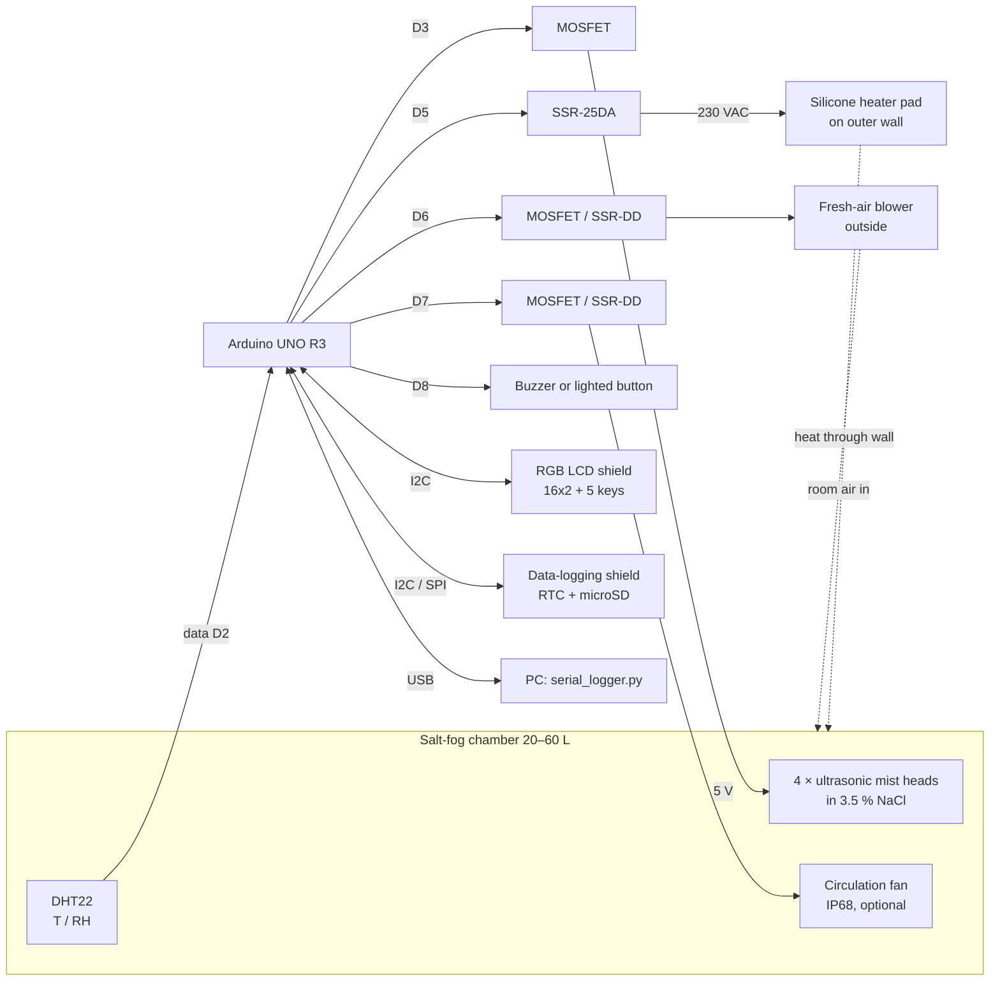

# Control System Design

## 1. Requirements

| Item | Requirement | How it is met |
|---|---|---|
| Controller | Arduino UNO R3 | ATmega328P. The sketch uses 31,870 of 32,256 bytes of flash and 1,480 of 2,048 bytes of static RAM |
| Environment | salt fog of 3.5 wt% NaCl (ASTM conformance not required) | 4 USB ultrasonic mist heads in the salt solution, switched together |
| Sensor | 1 × DHT | **DHT22 / AM2302** (see §5) |
| Set-points | target %RH and °C | from the LCD keypad or USB serial, saved in EEPROM |
| Tolerance | ±2 %RH, ±1 °C | PID / split-range PI. Simulated worst case over 11 chamber variants: ±0.77 °C, ±1.47 %RH |
| Display / input | 16×2 I²C LCD shield with buttons | Adafruit RGB LCD Shield (MCP23017, 5 keys, uses A4/A5 only) |
| Recording | T and RH logged | CSV on microSD (RTC time stamps) and CSV on USB serial |
| Corrosion | heater and fans must survive the salt fog | heater pad and fresh-air blower are mounted **outside** the fog ([design-notes-th.md §2.4](design-notes-th.md)) |

## 2. Architecture



| Actuator | Effect | Control signal |
|---|---|---|
| Silicone heater pad (230 VAC, 100–150 W) on the outer wall | raises T (and lowers RH) | D5 → SSR-25DA, time-proportioned in a 2 s window |
| 4 × ultrasonic mist heads (5 V USB, all together) | adds salt fog, raises RH | D3 → MOSFET, time-proportioned in a 5 s window |
| Fresh-air blower outside + passive outlet | lowers RH (and T) by blowing drier room air in | D6, time-proportioned in a 10 s window |
| Circulation fan (optional, IP68) | mixes the air | D7, on while running |
| Alarm (buzzer or lighted button) | tells the operator | D8, blinks 0.4 s every 1.2 s |

**Every output is on/off.** Each output's demand of *x* % becomes ON for *x* % of a fixed window. This works with MOSFET modules, DC SSRs and zero-cross AC SSRs alike; fast PWM would not work with an AC SSR. On-times shorter than the minimum (e.g. 0.5 s for the mist heads) are carried over to the next window, so the average is still exact.

The system has no cooler. The temperature set-point must be at least ~3 °C above room temperature. RH can only be lowered to the room's absolute humidity at chamber temperature.

## 3. Control loops

The DHT22 is read every **2 s**, which is its maximum rate. Both loops run at that period.

### 3.1 Temperature → heater (PID)

```
e      = T_set − T
P      = T_KP · e                         T_KP = 15   %/°C
I     += T_KI · e · dt  (only |e| ≤ 1.5)  T_KI = 0.03 %/(°C·s)
D      = −T_KD · dT/dt  (on measurement)  T_KD = 180  %/(°C/s)
heater = clamp(P + I + D, 0, 100) %      → 2 s time-proportioning on D5
```

* **Anti-windup.** The integral only runs while |e| ≤ 1.5 °C (`T_IZONE`) and while the output is not saturated in the same direction. This prevents overshoot after heat-up or after the lid has been opened.
* **Strong derivative.** The heater pad heats the wall first and the air later, so the loop has extra lag. The derivative term brakes the heater before the stored wall heat overshoots.
* **Heat-venting is a last resort.** Only if T is more than 1.5 °C above set-point with the heater already off is the fresh-air blower forced to at least 50 %. Venting also dries the fog, so the threshold sits outside the ±1 °C band.

### 3.2 Humidity → mist heads / fresh-air blower (split-range PI)

```
e = RH_set − RH
u = RH_KP · e + I            RH_KP = 5 %/%RH,  RH_KI = 0.01 %/(%RH·s),  integral zone ±5 %RH

u > 0  → mist heads       = u    (5 s window, min ON 0.5 s)
u < 0  → fresh-air blower = −u   (10 s window, min ON 1.5 s)
```

One continuous PI drives both actuators, so the mist heads and the blower never run together, and the hand-over between them is smooth. In practice the chamber loses moisture through leaks and the passive outlet, so the blower is rarely needed. The simulation never used it in steady state.

### 3.3 Coupling between T and RH

At 35 °C / 80 %RH, **a 1 °C change in air temperature changes RH by about 4.3 %RH** at constant moisture content. Holding ±2 %RH therefore needs temperature held to about ±0.3 °C. That is why the temperature loop is tuned tighter than ±1 °C, and why the heater-to-air coupling matters (§6).

## 4. Supervisory logic and safety

| Condition | Action |
|---|---|
| DHT22 fails 3 reads in a row (6 s) | heater, mist heads and blower off; LCD red "!SENSOR FAIL"; alarm output blinks |
| T ≥ 60 °C (`T_ABS_MAX`) | heater and mist off, blower 100 %, alarm |
| Out of tolerance > 10 min after having been stable (e.g. salt solution ran out, lid left open, heater failed) | "!OUT OF BAND" alarm, logged |
| Any key press | acknowledges the current alarms (the output stops blinking) |
| Program hang | 8 s hardware watchdog. All outputs start OFF and the settings are restored from EEPROM |
| Independent of software | **72 °C thermal fuse on the heater pad** |

**Removed to fit the UNO:** the salt-solution low-level switch and the door switch. Check the solution level by eye, and press STOP before opening the lid. See [design-notes-th.md §1](design-notes-th.md).

**Stability statistics.** Once T and RH have stayed in tolerance for 5 minutes, the chamber is marked **stable** and the backlight turns green. From then on the controller counts the in-tolerance fraction and the maximum |ΔT| and |ΔRH|.

## 5. Sensor choice: DHT22 (AM2302)

| | DHT11 | **DHT22 / AM2302** |
|---|---|---|
| RH range / accuracy | 20–80 %, ±5 % | **0–100 %, ±2 % typ.** |
| T accuracy | ±2 °C | **±0.5 °C** |
| Resolution | 1 %RH / 1 °C | **0.1 %RH / 0.1 °C** |

The DHT11 cannot meet ±1 °C / ±2 %RH. In salt fog the DHT22 needs a filter cap and conformal coating, and must be kept out of the direct mist. Treat it as a consumable and check it periodically. A saturated NaCl jar gives 75.3 %RH at 25 °C, and offsets go in `config.h` as `T_OFFSET` / `RH_OFFSET`.

## 6. Achieving the tolerance: chamber guidelines

1. **Couple the heater well to the air.** Bond the pad to a **thin aluminium wall/floor (2–3 mm) coated on the fog side**, not to thick plastic. In simulation, a heavy, poorly conducting wall (2 kJ/K, 2 W/K) still held the steady state, but overshot to 1.26 °C for several minutes after the lid was opened.
2. **Insulate** the outside, covering the heater pad too.
3. **Keep the mist plume off the sensor** with a baffle. Never let droplets land on the DHT22.
4. **Fresh air in, fog out.** The blower outside pushes room air in, and a passive outlet with a water trap lets fog out.
5. **Keep the set-point at least 3 °C above room temperature**, because there is no cooling.

## 7. Verification by simulation

The unmodified firmware was compiled on a PC against stubbed Arduino I/O and run in closed loop at the real 2 s control period. The code is in [`test/sim/`](../test/sim/); run `test/sim/run.sh`, which CI also runs on every push. The model includes:

* a heater pad heating a wall node, which heats the air
* air heat loss and blower venting
* moisture balance with mist input, leakage and venting
* Magnus saturation
* first-order DHT22 lag and 0.1-unit quantisation

The 8-hour scenario: 25 °C / 60 %RH → **35 °C / 80 %RH** → step to **40 °C / 70 %RH** at 4 h → **lid opened for 60 s** at 6 h.


| Chamber variant | 35 °C / 80 % steady | 40 °C / 70 % steady | 15 min after lid opening → end |
|---|---|---|---|
| nominal: air 3 kJ/K, wall 0.8 kJ/K @ 4 W/K, 100 W pad, mist 0.3 g/m³s, sensor τ 10 s | ±0.07 °C, ±0.69 %RH | ±0.06 °C, ±0.30 %RH | ±0.46 °C, ±0.59 %RH |
| 2× mist, sensor τ 20 s | ±0.08 °C, ±0.93 %RH | ±0.06 °C, ±0.62 %RH | ±0.51 °C, ±0.65 %RH |
| 3× mist, sensor τ 30 s | ±0.08 °C, ±1.47 %RH | ±0.07 °C, ±1.06 %RH | ±0.55 °C, ±1.15 %RH |
| ½× mist, sensor τ 5 s | ±0.06 °C, ±0.33 %RH | ±0.06 °C, ±0.27 %RH | ±0.45 °C, ±0.78 %RH |
| low thermal mass, poor insulation | ±0.06 °C, ±0.64 %RH | ±0.05 °C, ±0.31 %RH | ±0.39 °C, ±0.47 %RH |
| tiny box, strong mist, τ 25 s | ±0.02 °C, ±1.13 %RH | ±0.11 °C, ±0.89 %RH | ±0.12 °C, ±0.91 %RH |
| large thermal mass, 150 W | ±0.07 °C, ±0.65 %RH | ±0.08 °C, ±0.30 %RH | ±0.77 °C, ±0.44 %RH |
| small heater 50 W | ±0.04 °C, ±0.65 %RH | ±0.02 °C, ±0.33 %RH | ±0.43 °C, ±0.39 %RH |
| cold, dry room (20 °C, 40 %RH) | ±0.06 °C, ±0.44 %RH | ±0.07 °C, ±0.39 %RH | ±0.49 °C, ±0.71 %RH |
| warm, humid room (30 °C, 75 %RH) | ±0.07 °C, ±0.45 %RH | ±0.06 °C, ±0.38 %RH | ±0.51 °C, ±0.52 %RH |
| *thick plastic wall 2 kJ/K @ 2 W/K (informational)* | ±0.38 °C, ±0.67 %RH | ±0.51 °C, ±0.45 %RH | **±1.26 °C**, ±0.53 %RH (90.7 % in band) |

All variants except the informational thick-wall case stayed **100 % within ±1 °C / ±2 %RH**. The model is well mixed, so a real chamber will show more ripple. Confirm on the hardware ([operation.md §5](operation.md#5-tuning-on-the-real-chamber)).

## 8. Timing summary

| Task | Period |
|---|---|
| DHT22 read + both control loops | 2 s |
| Heater time-proportioning | 2 s window, min ON 20 ms |
| Mist heads time-proportioning | 5 s window, min ON 0.5 s (carry-over) |
| Fresh-air blower time-proportioning | 10 s window, min ON 1.5 s |
| Keypad poll / LCD refresh | 50 ms / 500 ms |
| Log record (SD + serial) | 60 s default (1–3600 s) |
| Watchdog | 8 s |
