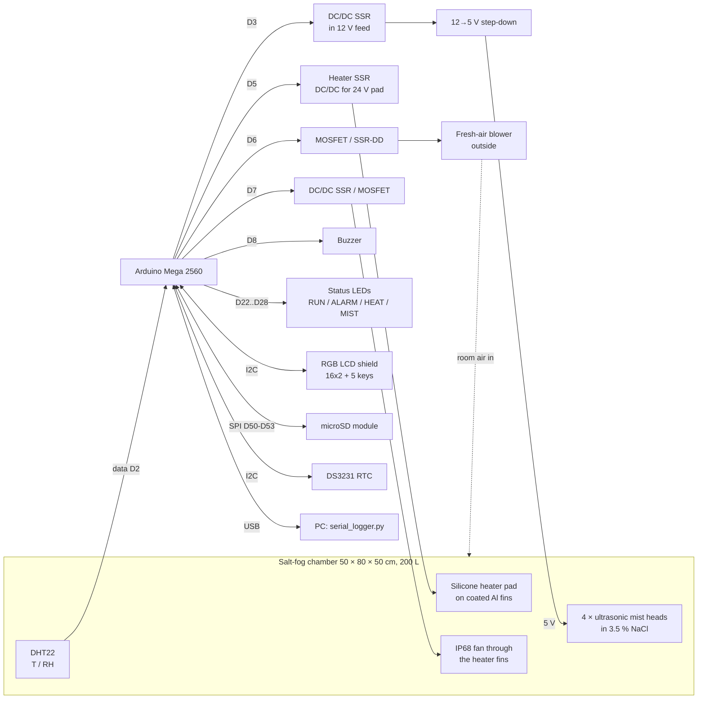

# Control System Design

## 1. Requirements

| Item | Requirement | How it is met |
|---|---|---|
| Controller | Arduino Mega 2560 | ATmega2560. The sketch uses ~34 KB of 256 KB flash and 1.5 KB of 8 KB RAM |
| Chamber | plastic box 50 × 80 × 50 cm (W × L × H) = 200 L | 4 mist heads are sufficient (7–28 % duty). Heater 200 W with 20 mm insulation, 300 W without |
| Environment | salt fog of 3.5 wt% NaCl (ASTM conformance not required) | 4 USB ultrasonic mist heads in the salt solution, switched together |
| Sensor | 1 × DHT | **DHT22 / AM2302** (see §5) |
| Operating range | **20–40 °C or ROOM**, **20–80 %RH**, humidity mainly by the mist | heater only (no cooler). RH below the room air's moisture needs a dried inlet (§3.3) |
| Set-points | target %RH and °C | from the LCD keypad or USB serial, saved in EEPROM |
| Tolerance | ±2 %RH, ±1 °C | PID / split-range PI. Simulated worst case over 15 chamber variants: ±0.71 °C, ±1.26 %RH |
| Display / input | 16×2 I²C LCD shield with buttons | Adafruit RGB LCD Shield (MCP23017, 5 keys, I²C only) |
| Status indication | buzzer + LEDs | buzzer (D8), green RUN / red ALARM / amber HEATER / blue MIST LEDs (D22–D28), plus the LCD backlight colour |
| Recording | T and RH logged | CSV on a microSD module (DS3231 time stamps) and CSV on USB serial |
| Partial builds | modules can be fitted later | runs with any module missing, reports what it found, re-detects SD / RTC / LCD every minute |
| Corrosion | heater module sits inside the salt fog | 24 VDC pad, coated heat sink, sealed leads, IP68 fan, bimetal + thermal fuse, mounted away from the mist ([design-notes-th.md §0.5](design-notes-th.md)). The fresh-air blower is outside |

## 2. Architecture



| Actuator | Effect | Control signal |
|---|---|---|
| Silicone heater pad (24 VDC preferred, 200–300 W) on a finned Al heat sink inside the chamber | raises T (and lowers RH) | D5 → heater SSR, time-proportioned in a 2 s window |
| 4 × ultrasonic mist heads (5 V USB, own drivers, all together) | adds salt fog, raises RH | D3 → DC/DC SSR in the 12 V feed of the 12→5 V step-down (or in the + line of a separate 5 V supply): timed bursts in a 4 s window, ≥ 0.3 s each (or SSR on the adapter's 230 V input: 6 s window, ≥ 1 s) |
| Fresh-air blower outside + passive outlet | lowers RH (and T) by blowing drier room air in | D6, time-proportioned in a 10 s window |
| Heater / circulation fan (IP68) | blows air through the heater fins and mixes the chamber | D7, **on whenever running** (the heater never heats without air flow) |
| Buzzer | tells the operator about new alarms | D8, beeps 0.4 s every 1.2 s until a key is pressed |
| Status LEDs | show the state at a glance | D22 green RUN (steady = in tolerance, blink = settling), D24 red ALARM (fast blink = new, steady = acknowledged), D26 amber HEATER, D28 blue MIST |

**Every output is on/off.** Each output's demand of *x* % becomes ON for *x* % of a fixed window. This works with MOSFET modules, DC SSRs and zero-cross AC SSRs alike; fast PWM would not work with an AC SSR. On-times shorter than the minimum (e.g. 0.5 s for the mist heads) are carried over to the next window, so the average is still exact.

The system has no cooler. The temperature set-point must be at least ~3 °C above room temperature. RH can only be lowered to the room's absolute humidity at chamber temperature.

## 3. Control loops

The DHT22 is read every **2 s**, which is its maximum rate. Both loops run at that period.

### 3.1 Temperature → heater (PID)

```
e      = T_set − T
P      = T_KP · e                         T_KP = 15   %/°C
I     += T_KI · e · dt  (only |e| ≤ 1.5)  T_KI = 0.03 %/(°C·s)
D      = −T_KD · dT/dt  (on measurement)  T_KD = 180  %/(°C/s)
heater = clamp(P + I + D, 0, 100) %      → 2 s time-proportioning on D5
```

* **Anti-windup.** Outside ±1.5 °C (`T_IZONE`) the integral pauses while T is still ramping towards the set-point (faster than 1.5 °C per 5 min), which prevents overshoot after heat-up or after the lid is opened. It does run if T stalls short of the set-point, for example when the heater is only just big enough. It never integrates further into saturation. The humidity loop works the same way with a ±5 %RH zone.
* **Strong derivative.** The pad heats the heat sink first and the air afterwards, so the loop has extra lag. The derivative term brakes the heater before the heat stored in the fins overshoots.
* **Heat-venting is a last resort.** Only if T is more than 1.5 °C above set-point with the heater already off is the fresh-air blower forced to at least 50 %. Venting also dries the fog, so the threshold sits outside the ±1 °C band.

### 3.2 Humidity → mist heads / fresh-air blower (split-range PI)

```
e = RH_set − RH
u = RH_KP · e + I            RH_KP = 3 %/%RH,  RH_KI = 0.006 %/(%RH·s),  integral zone ±5 %RH

u > 0  → mist heads       = u    (timed bursts: 4 s window, min burst 0.3 s)
u < 0  → fresh-air blower = −u   (10 s window, min ON 1.5 s)
```

One continuous PI drives both actuators, so the mist heads and the blower never run together, and the hand-over between them is smooth. In practice the chamber loses moisture through leaks and the passive outlet, so the blower is mainly used to step RH down.

**Why the mist bursts are short.** The heads have their own drivers, so the Arduino can only switch their supply on and off. The shortest burst therefore sets the RH ripple. In the 200 L chamber, 4 heads (~35 mL/h each) add about **0.25 %RH per 0.5 s of mist at 35 °C** (~0.4 % at 25 °C), so both switch types pass:

| Mist switch | Shortest burst | Result in 200 L |
|---|---|---|
| DC/DC SSR (12 V or 5 V side) or MOSFET (`MIST_AC_SIDE_SWITCH 0`, default) | 0.3 s | ±0.3 %RH steady ✅ |
| SSR on the 230 V input of a USB adapter (`MIST_AC_SIDE_SWITCH 1`) | ~1 s | ±0.3 %RH steady ✅ |

In a small box (40–60 L) the same heads add ~1 %RH per 0.5 s. There, the 1 s bursts of the 230 V-side option reached ±2.2 %RH in simulation, so the DC switch is the safer choice.

### 3.3 Operating range and its physical limits

* **Temperature 20–40 °C, or ROOM.** Below 20.0 °C in the menu (or `SET T ROOM`) the heater is disabled and the temperature is only logged; the ±1 °C check is skipped. Because there is no cooler, a set-point must be at least ~3 °C above room temperature.
* **Humidity 20–80 %RH.** The mist can only add moisture. The lowest reachable RH is the room air's moisture content at chamber temperature: for a room at 25 °C / 50 %RH it is 50 / 37 / 28 / 21 %RH at 25 / 30 / 35 / 40 °C, and for 30 °C / 70 %RH it is 70 / 53 / 40 %RH at 30 / 35 / 40 °C. Lower set-points need a silica-gel cartridge on the fresh-air blower inlet, or dry compressed air.
* NaCl deliquesces at ~75 %RH. Below that, salt deposited on specimens dries to crystals, so the corrosion rate drops sharply.

### 3.4 Coupling between T and RH

At 35 °C / 80 %RH, **a 1 °C change in air temperature changes RH by about 4.3 %RH** at constant moisture content. Holding ±2 %RH therefore needs temperature held to about ±0.3 °C. That is why the temperature loop is tuned tighter than ±1 °C, and why the heater-to-air coupling matters (§6).

## 4. Supervisory logic and safety

| Condition | Action |
|---|---|
| DHT22 fails 3 reads in a row (6 s) | heater, mist heads and blower off; LCD red "!SENSOR FAIL"; buzzer beeps, red LED blinks |
| T ≥ 60 °C (`T_ABS_MAX`) | heater and mist off, blower 100 %, alarm |
| Out of tolerance > 10 min after having been stable (e.g. salt solution ran out, lid left open, heater failed) | "!OUT OF BAND" alarm, logged |
| Any key press | acknowledges the current alarms: the buzzer stops, and the red LED goes from blinking to steady |
| Program hang | 8 s hardware watchdog. All outputs start OFF and the settings are restored from EEPROM |
| I²C fault (loose wire, short) | 25 ms I²C timeout resets the bus instead of hanging; the module is reported lost and searched for again |
| SD card missing or removed | logging continues on USB serial; the card is searched for every minute (heater/mist held off during the ~2 s search) |
| Independent of software | **KSD301 75 °C bimetal + ~100 °C thermal fuse on the heater heat sink** (also cover a stopped fan, which software cannot detect) |

**Not fitted (by choice):** the salt-solution low-level switch and the door switch. Check the solution level by eye, and press STOP before opening the lid. See [design-notes-th.md §1](design-notes-th.md).

**Stability statistics.** Once T and RH have stayed in tolerance for 5 minutes, the chamber is marked **stable** and the backlight turns green. From then on the controller counts the in-tolerance fraction and the maximum |ΔT| and |ΔRH|.

## 5. Sensor choice: DHT22 (AM2302)

| | DHT11 | **DHT22 / AM2302** |
|---|---|---|
| RH range / accuracy | 20–80 %, ±5 % | **0–100 %, ±2 % typ.** |
| T accuracy | ±2 °C | **±0.5 °C** |
| Resolution | 1 %RH / 1 °C | **0.1 %RH / 0.1 °C** |

The DHT11 cannot meet ±1 °C / ±2 %RH. In salt fog the DHT22 needs a filter cap and conformal coating, and must be kept out of the direct mist. Treat it as a consumable and check it periodically. A saturated NaCl jar gives 75.3 %RH at 25 °C, and offsets go in `config.h` as `T_OFFSET` / `RH_OFFSET`.

## 6. Achieving the tolerance: chamber guidelines

1. **Size the heater to the box.** For 200 L, use 200 W with 20 mm insulation or 300 W without. A 100 W pad held the set-points in simulation, but heats up slowly and recovers worst after the lid is opened (±0.71 °C).
2. **Insulate** the outside (20 mm PE/XPS). This cuts heat loss about three-fold and evens out wall temperatures.
3. **Keep the mist plume off the sensor** with a baffle. Never let droplets land on the DHT22.
4. **Fresh air in, fog out.** The blower outside pushes room air in, and a passive outlet with a water trap lets fog out.
5. **Keep the set-point at least 3 °C above room temperature**, because there is no cooling.

## 7. Verification by simulation

The unmodified firmware was compiled on a PC against stubbed Arduino I/O and run in closed loop at the real 2 s control period. The code is in [`test/sim/`](../test/sim/); run `test/sim/run.sh`, which CI also runs on every push. The model includes:

* a 200 L chamber; the heater pad heats the heat sink, and the fan carries that heat into the air
* latent heat taken by the evaporating mist (2450 J/g)
* air heat loss and blower venting
* moisture balance with mist input, leakage and venting
* Magnus saturation
* first-order DHT22 lag and 0.1-unit quantisation

The 8-hour scenario: room conditions → **set-point 1** → step to **set-point 2** at 4 h → **lid opened for 60 s** at 6 h. The chart shows the nominal case (35 °C / 70 % → 40 °C / 40 %).


Default: room 25 °C / 60 %RH; chamber 200 L with 20 mm insulation (2.3 W/K, 6 kJ/K); 200 W pad on a 450 J/K heat sink coupled at 10 W/K by the fan; 4 mist heads ≈ 0.19 g/m³s; DC mist switch; sensor lag 15 s; set-points 35 °C / 70 % then 40 °C / 40 %, unless stated.

| Chamber variant | set-point 1 steady | set-point 2 steady | 15 min after lid opening → end |
|---|---|---|---|
| nominal | ±0.05 °C, ±0.27 %RH | ±0.01 °C, ±0.12 %RH | ±0.48 °C, ±0.61 %RH |
| uninsulated, 300 W | ±0.05 °C, ±0.28 %RH | ±0.01 °C, ±0.12 %RH | ±0.28 °C, ±0.71 %RH |
| uninsulated, 200 W | ±0.01 °C, ±0.24 %RH | ±0.05 °C, ±0.19 %RH | ±0.35 °C, ±0.73 %RH |
| small heater 100 W | ±0.03 °C, ±0.25 %RH | ±0.02 °C, ±0.14 %RH | ±0.71 °C, ±0.39 %RH |
| heavy contents (15 kJ/K) | ±0.03 °C, ±0.24 %RH | ±0.00 °C, ±0.11 %RH | ±0.47 °C, ±0.37 %RH |
| light contents (3 kJ/K) | ±0.07 °C, ±0.33 %RH | ±0.01 °C, ±0.13 %RH | ±0.30 °C, ±0.68 %RH |
| weak heater fan (4 W/K) | ±0.06 °C, ±0.26 %RH | ±0.01 °C, ±0.12 %RH | ±0.58 °C, ±0.82 %RH |
| poor mixing, sensor lag 30 s | ±0.06 °C, ±0.31 %RH | ±0.01 °C, ±0.13 %RH | ±0.54 °C, ±0.67 %RH |
| strong mist (0.35 g/m³s) | ±0.05 °C, ±0.34 %RH | ±0.01 °C, ±0.23 %RH | ±0.47 °C, ±0.71 %RH |
| weak mist (0.10 g/m³s) | ±0.05 °C, ±0.26 %RH | ±0.01 °C, ±0.09 %RH | ±0.46 °C, ±1.02 %RH |
| ROOM mode, 75 % → 40 % (room 25 °C / 30 %) | –, ±0.33 %RH | –, ±0.20 %RH | –, ±0.33 %RH |
| low limit 20 °C, 80 % → 50 % (room 17 °C) | ±0.06 °C, ±0.38 %RH | ±0.04 °C, ±0.21 %RH | ±0.14 °C, ±0.33 %RH |
| 30 °C / 50 % → 40 °C / 20 % (dry room 25 °C / 35 %) | ±0.03 °C, ±0.20 %RH | ±0.05 °C, ±0.11 %RH | ±0.37 °C, ±0.36 %RH |
| Thai room 30 °C / 70 %: 35 °C / 75 % → 40 °C / 80 % | ±0.01 °C, ±0.18 %RH | ±0.04 °C, ±0.30 %RH | ±0.51 °C, ±1.26 %RH |
| mist switched on the 230 V side of a USB adapter | ±0.05 °C, ±0.32 %RH | ±0.01 °C, ±0.23 %RH | ±0.47 °C, ±0.97 %RH |

All variants stayed **100 % within ±1 °C / ±2 %RH**. The model is well mixed, so a real chamber will show more ripple. Confirm on the hardware ([operation.md §5](operation.md#5-tuning-on-the-real-chamber)).

## 8. Timing summary

| Task | Period |
|---|---|
| DHT22 read + both control loops | 2 s |
| Heater time-proportioning | 2 s window, min ON 20 ms |
| Mist heads (timed bursts) | 4 s window, min burst 0.3 s, carry-over (230 V-side option: 6 s / 1 s) |
| Fresh-air blower time-proportioning | 10 s window, min ON 1.5 s |
| Keypad poll / LCD refresh | 50 ms / 500 ms |
| Log record (SD + serial) | 60 s default (1–3600 s) |
| Watchdog | 8 s |
