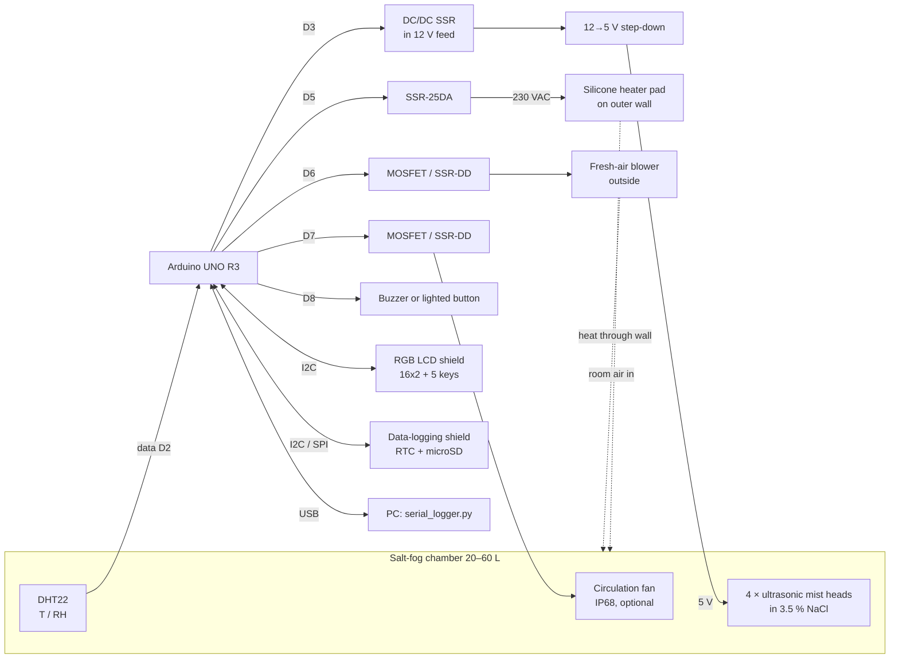

# Control System Design

## 1. Requirements

| Item | Requirement | How it is met |
|---|---|---|
| Controller | Arduino UNO R3 | ATmega328P. The sketch uses 31,958 of 32,256 bytes of flash and 1,475 of 2,048 bytes of static RAM |
| Environment | salt fog of 3.5 wt% NaCl (ASTM conformance not required) | 4 USB ultrasonic mist heads in the salt solution, switched together |
| Sensor | 1 × DHT | **DHT22 / AM2302** (see §5) |
| Operating range | **20–40 °C or ROOM**, **20–80 %RH**, humidity mainly by the mist | heater only (no cooler). RH below the room air's moisture needs a dried inlet (§3.3) |
| Set-points | target %RH and °C | from the LCD keypad or USB serial, saved in EEPROM |
| Tolerance | ±2 %RH, ±1 °C | PID / split-range PI. Simulated worst case over 13 chamber variants: ±0.78 °C, ±1.30 %RH |
| Display / input | 16×2 I²C LCD shield with buttons | Adafruit RGB LCD Shield (MCP23017, 5 keys, uses A4/A5 only) |
| Recording | T and RH logged | CSV on microSD (RTC time stamps) and CSV on USB serial |
| Corrosion | heater and fans must survive the salt fog | heater pad and fresh-air blower are mounted **outside** the fog ([design-notes-th.md §2.4](design-notes-th.md)) |

## 2. Architecture



| Actuator | Effect | Control signal |
|---|---|---|
| Silicone heater pad (230 VAC, 100–150 W) on the outer wall | raises T (and lowers RH) | D5 → SSR-25DA, time-proportioned in a 2 s window |
| 4 × ultrasonic mist heads (5 V USB, own drivers, all together) | adds salt fog, raises RH | D3 → DC/DC SSR in the 12 V feed of the 12→5 V step-down (or in the + line of a separate 5 V supply): timed bursts in a 4 s window, ≥ 0.3 s each (or SSR on the adapter's 230 V input: 6 s window, ≥ 1 s) |
| Fresh-air blower outside + passive outlet | lowers RH (and T) by blowing drier room air in | D6, time-proportioned in a 10 s window |
| Circulation fan (optional, IP68) | mixes the air | D7, on while running |
| Alarm (buzzer or lighted button) | tells the operator | D8, blinks 0.4 s every 1.2 s |

**Every output is on/off.** Each output's demand of *x* % becomes ON for *x* % of a fixed window. This works with MOSFET modules, DC SSRs and zero-cross AC SSRs alike; fast PWM would not work with an AC SSR. On-times shorter than the minimum (e.g. 0.5 s for the mist heads) are carried over to the next window, so the average is still exact.

The system has no cooler. The temperature set-point must be at least ~3 °C above room temperature. RH can only be lowered to the room's absolute humidity at chamber temperature.

## 3. Control loops

The DHT22 is read every **2 s**, which is its maximum rate. Both loops run at that period.

### 3.1 Temperature → heater (PID)

```
e      = T_set − T
P      = T_KP · e                         T_KP = 15   %/°C
I     += T_KI · e · dt  (only |e| ≤ 1.5)  T_KI = 0.03 %/(°C·s)
D      = −T_KD · dT/dt  (on measurement)  T_KD = 180  %/(°C/s)
heater = clamp(P + I + D, 0, 100) %      → 2 s time-proportioning on D5
```

* **Anti-windup.** The integral only runs while |e| ≤ 1.5 °C (`T_IZONE`) and while the output is not saturated in the same direction. This prevents overshoot after heat-up or after the lid has been opened.
* **Strong derivative.** The heater pad heats the wall first and the air later, so the loop has extra lag. The derivative term brakes the heater before the stored wall heat overshoots.
* **Heat-venting is a last resort.** Only if T is more than 1.5 °C above set-point with the heater already off is the fresh-air blower forced to at least 50 %. Venting also dries the fog, so the threshold sits outside the ±1 °C band.

### 3.2 Humidity → mist heads / fresh-air blower (split-range PI)

```
e = RH_set − RH
u = RH_KP · e + I            RH_KP = 3 %/%RH,  RH_KI = 0.006 %/(%RH·s),  integral zone ±5 %RH

u > 0  → mist heads       = u    (timed bursts: 4 s window, min burst 0.3 s)
u < 0  → fresh-air blower = −u   (10 s window, min ON 1.5 s)
```

One continuous PI drives both actuators, so the mist heads and the blower never run together, and the hand-over between them is smooth. In practice the chamber loses moisture through leaks and the passive outlet, so the blower is mainly used to step RH down.

**Why the mist bursts must be short.** The heads have their own drivers, so the Arduino can only switch their 5 V supply on and off. Four heads (~30–40 mL/h each) in a 40–60 L box add about **1 %RH per 0.5 s of mist**. The minimum burst therefore sets the RH ripple. At 25 °C (ROOM mode), where 1 g/m³ ≈ 4.3 %RH, simulation with strong mist gives:

| Mist switch | Shortest burst | Worst RH deviation |
|---|---|---|
| DC/DC SSR (12 V or 5 V side) or MOSFET (`MIST_AC_SIDE_SWITCH 0`, default) | 0.3 s | ±1.3 %RH ✅ |
| SSR on the 230 V input of a USB adapter (`MIST_AC_SIDE_SWITCH 1`) | 1 s (adapter start-up ~0.5 s) | ±2.2 %RH ❌; passes with moderate mist (bigger box / fewer heads) |

### 3.3 Operating range and its physical limits

* **Temperature 20–40 °C, or ROOM.** Below 20.0 °C in the menu (or `SET T ROOM`) the heater is disabled and the temperature is only logged; the ±1 °C check is skipped. Because there is no cooler, a set-point must be at least ~3 °C above room temperature.
* **Humidity 20–80 %RH.** The mist can only add moisture. The lowest reachable RH is the room air's moisture content at chamber temperature: for a room at 25 °C / 50 %RH it is 50 / 37 / 28 / 21 %RH at 25 / 30 / 35 / 40 °C, and for 30 °C / 70 %RH it is 70 / 53 / 40 %RH at 30 / 35 / 40 °C. Lower set-points need a silica-gel cartridge on the fresh-air blower inlet, or dry compressed air.
* NaCl deliquesces at ~75 %RH. Below that, salt deposited on specimens dries to crystals, so the corrosion rate drops sharply.

### 3.4 Coupling between T and RH

At 35 °C / 80 %RH, **a 1 °C change in air temperature changes RH by about 4.3 %RH** at constant moisture content. Holding ±2 %RH therefore needs temperature held to about ±0.3 °C. That is why the temperature loop is tuned tighter than ±1 °C, and why the heater-to-air coupling matters (§6).

## 4. Supervisory logic and safety

| Condition | Action |
|---|---|
| DHT22 fails 3 reads in a row (6 s) | heater, mist heads and blower off; LCD red "!SENSOR FAIL"; alarm output blinks |
| T ≥ 60 °C (`T_ABS_MAX`) | heater and mist off, blower 100 %, alarm |
| Out of tolerance > 10 min after having been stable (e.g. salt solution ran out, lid left open, heater failed) | "!OUT OF BAND" alarm, logged |
| Any key press | acknowledges the current alarms (the output stops blinking) |
| Program hang | 8 s hardware watchdog. All outputs start OFF and the settings are restored from EEPROM |
| Independent of software | **72 °C thermal fuse on the heater pad** |

**Removed to fit the UNO:** the salt-solution low-level switch and the door switch. Check the solution level by eye, and press STOP before opening the lid. See [design-notes-th.md §1](design-notes-th.md).

**Stability statistics.** Once T and RH have stayed in tolerance for 5 minutes, the chamber is marked **stable** and the backlight turns green. From then on the controller counts the in-tolerance fraction and the maximum |ΔT| and |ΔRH|.

## 5. Sensor choice: DHT22 (AM2302)

| | DHT11 | **DHT22 / AM2302** |
|---|---|---|
| RH range / accuracy | 20–80 %, ±5 % | **0–100 %, ±2 % typ.** |
| T accuracy | ±2 °C | **±0.5 °C** |
| Resolution | 1 %RH / 1 °C | **0.1 %RH / 0.1 °C** |

The DHT11 cannot meet ±1 °C / ±2 %RH. In salt fog the DHT22 needs a filter cap and conformal coating, and must be kept out of the direct mist. Treat it as a consumable and check it periodically. A saturated NaCl jar gives 75.3 %RH at 25 °C, and offsets go in `config.h` as `T_OFFSET` / `RH_OFFSET`.

## 6. Achieving the tolerance: chamber guidelines

1. **Couple the heater well to the air.** Bond the pad to a **thin aluminium wall/floor (2–3 mm) coated on the fog side**, not to thick plastic. In simulation, a heavy, poorly conducting wall (2 kJ/K, 2 W/K) still held the steady state, but overshot to 1.26 °C for several minutes after the lid was opened.
2. **Insulate** the outside, covering the heater pad too.
3. **Keep the mist plume off the sensor** with a baffle. Never let droplets land on the DHT22.
4. **Fresh air in, fog out.** The blower outside pushes room air in, and a passive outlet with a water trap lets fog out.
5. **Keep the set-point at least 3 °C above room temperature**, because there is no cooling.

## 7. Verification by simulation

The unmodified firmware was compiled on a PC against stubbed Arduino I/O and run in closed loop at the real 2 s control period. The code is in [`test/sim/`](../test/sim/); run `test/sim/run.sh`, which CI also runs on every push. The model includes:

* a heater pad heating a wall node, which heats the air
* air heat loss and blower venting
* moisture balance with mist input, leakage and venting
* Magnus saturation
* first-order DHT22 lag and 0.1-unit quantisation

The 8-hour scenario: room conditions → **set-point 1** → step to **set-point 2** at 4 h → **lid opened for 60 s** at 6 h. The chart shows the nominal case (35 °C / 70 % → 40 °C / 40 %).


Default room 25 °C / 60 %RH, 4 mist heads ≈ 0.7 g/m³s (40–60 L box), fast DC mist switch (DC/DC SSR or MOSFET), set-points 35 °C / 70 % then 40 °C / 40 %, unless stated.

| Chamber variant | set-point 1 steady | set-point 2 steady | 15 min after lid opening → end |
|---|---|---|---|
| nominal | ±0.07 °C, ±0.53 %RH | ±0.06 °C, ±0.32 %RH | ±0.46 °C, ±0.56 %RH |
| ROOM mode, 75 % → 40 % (room 25 °C / 30 %) | –, ±0.76 %RH | –, ±0.45 %RH | –, ±0.52 %RH |
| low limit 20 °C, 80 % → 50 % (room 17 °C) | ±0.06 °C, ±0.87 %RH | ±0.06 °C, ±0.54 %RH | ±0.39 °C, ±0.59 %RH |
| 30 °C / 50 % → 40 °C / 20 % (dry room 25 °C / 35 %) | ±0.04 °C, ±0.53 %RH | ±0.06 °C, ±0.20 %RH | ±0.49 °C, ±0.26 %RH |
| Thai room 30 °C / 70 %: 35 °C / 75 % → 40 °C / 60 % | ±0.07 °C, ±0.51 %RH | ±0.07 °C, ±0.34 %RH | ±0.51 °C, ±0.51 %RH |
| weak mist (big box), sensor τ 5 s | ±0.06 °C, ±0.30 %RH | ±0.06 °C, ±0.25 %RH | ±0.45 °C, ±0.90 %RH |
| very strong mist, slow sensor τ 30 s | ±0.08 °C, ±0.81 %RH | ±0.07 °C, ±0.48 %RH | ±0.55 °C, ±0.57 %RH |
| very strong mist, ROOM 80 % → 30 % | –, ±1.30 %RH | –, ±0.59 %RH | –, ±0.60 %RH |
| low thermal mass, poor insulation | ±0.06 °C, ±0.53 %RH | ±0.05 °C, ±0.31 %RH | ±0.40 °C, ±0.36 %RH |
| tiny box, very strong mist | ±0.02 °C, ±0.94 %RH | ±0.11 °C, ±0.48 %RH | ±0.12 °C, ±0.45 %RH |
| large thermal mass, 150 W | ±0.08 °C, ±0.55 %RH | ±0.08 °C, ±0.33 %RH | ±0.78 °C, ±0.46 %RH |
| small heater 50 W | ±0.04 °C, ±0.50 %RH | ±0.02 °C, ±0.27 %RH | ±0.43 °C, ±0.35 %RH |
| 230 V-side mist switch, moderate mist | ±0.07 °C, ±0.88 %RH | ±0.06 °C, ±0.50 %RH | ±0.46 °C, ±0.79 %RH |
| *230 V-side mist switch, strong mist, ROOM (informational)* | –, **±2.24 %RH** | –, ±1.69 %RH | –, **±2.06 %RH** |
| *thick plastic wall 2 kJ/K @ 2 W/K (informational)* | ±0.38 °C, ±0.55 %RH | ±0.53 °C, ±0.36 %RH | **±1.22 °C**, ±0.46 %RH |

All variants except the two informational cases stayed **100 % within ±1 °C / ±2 %RH**. The model is well mixed, so a real chamber will show more ripple. Confirm on the hardware ([operation.md §5](operation.md#5-tuning-on-the-real-chamber)).

## 8. Timing summary

| Task | Period |
|---|---|
| DHT22 read + both control loops | 2 s |
| Heater time-proportioning | 2 s window, min ON 20 ms |
| Mist heads (timed bursts) | 4 s window, min burst 0.3 s, carry-over (230 V-side option: 6 s / 1 s) |
| Fresh-air blower time-proportioning | 10 s window, min ON 1.5 s |
| Keypad poll / LCD refresh | 50 ms / 500 ms |
| Log record (SD + serial) | 60 s default (1–3600 s) |
| Watchdog | 8 s |
